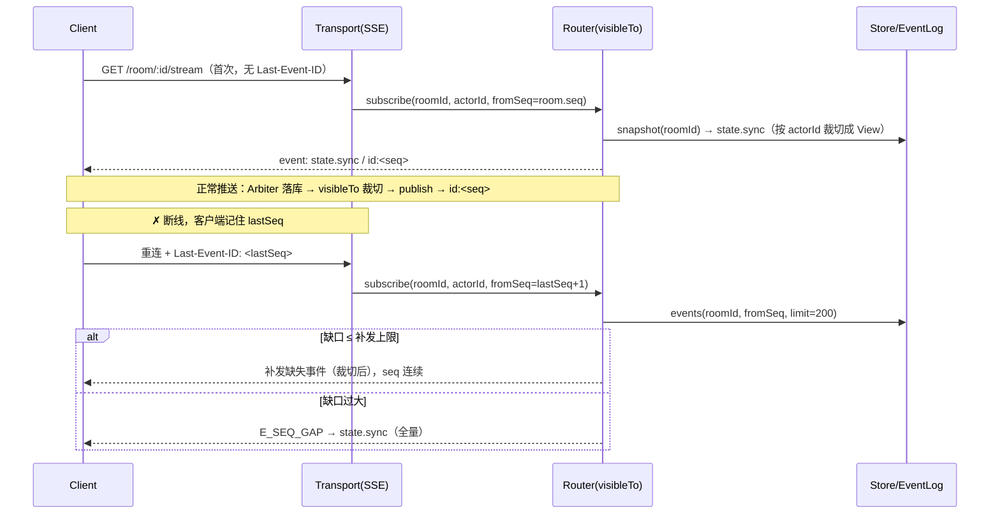
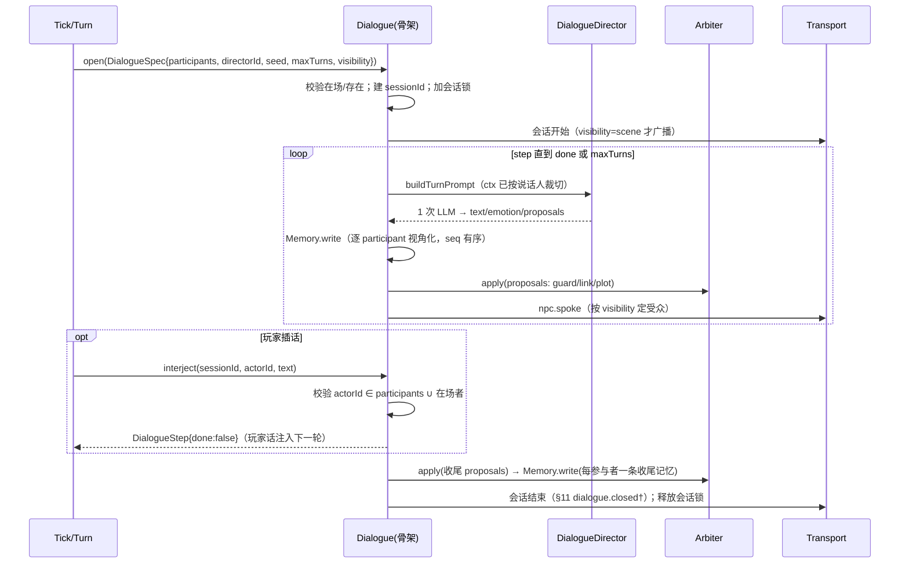

# 04 · 联机与多 Agent

> 名字来源：`03-接口总表.md`（本文接口名以它为准；带 `†` 的名字 03 尚无，见 §11）。立场：**现在不实现联机，但接口与纪律定死；将来加联机 = 加一个 `Transport` 实现，不改引擎。**

## 1. 现在就要守的 6 条纪律

不变量 I1（只有 `Arbiter.apply` 改状态）在联机下等价于"**每个房间只有一个写序列**"。下面 6 条都是给这个「单一写序列」铺路，现在做几乎零成本，事后返工要重写引擎。

| # | 纪律 | 现在必须怎么写 | 违反后将来怎么返工 | 机械检查 |
|---|---|---|---|---|
| 1 | **房间隔离** | 任何函数第一参数是 `roomId`；状态只能从 `WorldState.room` 取；禁止模块级/进程级可变单例（除 Registry 只读缓存） | 所有状态访问点重写为带 room 的 Map；存档格式全改；难度=重写引擎内核 | ESLint 禁 `export let`；单测同时开 2 个 room 跑同一用例 |
| 2 | **actorId 显式** | 动作/消息一律带 `actorId`，玩家 id 是 `plr_xxx` 不是 `"player"`；`TurnRequest.actorId` 必填；叙事模板用 `{{actor.name}}` 不写"你" | 全局 `currentPlayer` 会渗进 LLM prompt、记忆 owner、事件日志；替换成本=全仓搜索 | grep `"player"` 出现即告警；`Envelope` 的 `actorId` 为必填（TS 上非 optional） |
| 3 | **seq 单调 + 可续传** | seq 唯一分配点在 `Arbiter.apply` 成功后；每条 `Envelope` 写进 EventLog 才算存在；SSE 必须下发 `id: <seq>` | 无 `id:` 则 `EventSource` 不会带 `Last-Event-ID`，断线只能 `state.sync` 全量重拉，联机体验崩 | 断言 `seq === prevSeq + 1`；测试：订阅→断开→带 fromSeq 重连→事件不重不漏 |
| 4 | **回合幂等** | `clientTurnId` 落表 `(roomId, actorId, clientTurnId)`，重复提交直接回放已生成的 `TurnEvent` 序列 | 网络重试 = 双倍 token + 双倍状态变更；联机下两人重试会互相覆盖 | 同 `clientTurnId` 连发 2 次，断言 LLM 调用次数 = 1 |
| 5 | **前端不存权威状态** | 前端只渲染 `View` / `ViewPatch` / `Envelope`；本地只存 `lastSeq` 与未提交草稿 | 两人看到不同世界；`state.sync` 后前端状态与叙事文本矛盾 | 代码评审 + grep：前端不得有 `attrs` 写操作 |
| 6 | **时间服务端推** | 时间只由 `time.advance` op 推进，结果发 `clock.advanced`；前端禁止 setInterval 计游戏时间 | 各端时间不同步 → 密谋"昨晚"的判定分裂；回放不可复现 | 前端禁止出现 `Date.now()` 参与游戏逻辑 |

> 违反 1/2/3 的返工量是"重写"，违反 4/5/6 的是"大改"。**1、2、3 三条没有任何推迟的理由**。

## 2. 房间模型

`RoomState` 03 只被 `WorldState.room` 引用过、未定义字段，本文给出定义（待补进 03，见 §11）：

```ts
interface RoomState {
  roomId: string;                        // room_xxx
  mode: "solo" | "coop" | "pvp";
  ownerId: string;                       // 建房者 actorId（plr_xxx）
  members: RoomMember[];
  maxActors: number;                     // 见 config room.maxActors，建房后不可改
  inviteCode?: string;                   // coop/pvp 才有，6 位 [a-z0-9]
  status: "active" | "idle" | "closed";
  createdAt: number; lastActiveAt: number;
  seq: number;                           // 当前最新 seq
}
interface RoomMember {
  actorId: string;                       // 每个玩家一个 plr_*
  role: "owner" | "player" | "spectator";
  joinedSeq: number;                     // 从哪条事件开始可见
  presence: "online" | "offline";
  lastSeenAt: number;
}
```

### 2.1 三种模式的语义差异

| 维度 | `solo` | `coop` | `pvp` |
|---|---|---|---|
| 玩家数 / `maxActors` | 1（默认 1） | 2~4（默认 4） | 2（默认 2） |
| 谁能行动 | 唯一 `plr` | 任一在线 `player`，但**同一时刻只有一个 turn 在执行** | 任一，且允许同时提交 |
| 回合串行策略 | 无需锁 | 轮流 + 插话窗口（§4.1） | 同时提交、按序裁决（§4.2） |
| 时间怎么走 | 玩家行动驱动 | 任一玩家 `time.advance` 需房主确认或按"多数已就绪"自动推进 | 服务端按 `turn.committed` 计数推进，双方回合数对齐 |
| NPC 归谁 | 玩家 | **房主（owner）**——NPC 是世界的，不绑玩家；`actorId` 全是 `npc_*` | 同 coop，但 NPC 可为任一方"目标"，不可被任一方独占 |
| NPC 自主对话（§7） | 后台 tick | 同 solo，但 `visibility:"scene"` 的会话要向在场玩家广播 | 同 coop；`npc.plot` 默认 `private`，**不广播** |
| 密谋是否跨玩家 | 不适用 | 玩家共享同一世界 → 共享同一批密谋（这正是不作弊的难点） | 每个密谋只能涉及一侧 NPC，禁止跨侧 NPC 合谋（否则信息必泄） |
| 结束条件 | 玩家存档 | 房主解散 / 全员离开 | 房主解散 / 一方认输（模块自定义） |

> **solo 不是特例代码**：`RoomState` 永远有 `members[]`，solo 只是长度 1 的数组；引擎里禁止出现 `if (mode === "solo")` 的同步分支。

### 2.2 生命周期

状态机：`active ──全员 offline≥30min──▶ idle ──idle≥2h 或销毁──▶ closed`（`idle` 下任一成员重连即回 `active`）。

| 阶段 | 触发 | 动作 | 可观测 |
|---|---|---|---|
| 创建 | `POST /api/v1/room` | 分配 `room_xxx`、`inviteCode`；solo 自动加入 `plr_*`；`seq=0` | 返回 `{roomId, seq, state}` |
| 加入 | `POST /api/v1/room/:id/join` | 校验 `inviteCode` + `maxActors`；写 `room.member.joined`（占 seq） | 广播 `presence.update` |
| 离开 | `POST /api/v1/room/:id/leave` | 写 `room.member.left`；NPC 对离开者的记忆冻结（不再新增） | 广播 `presence.update` |
| 闲置回收 | 定时器（每 5min 扫） | `active → idle` 只标记不销毁；`idle → closed` 前先落快照 | `turn.error`/`state.sync` 通知在线者 |
| 解散 | 房主 `leave` 且 `members.length===0` | 落快照 → `closed` | — |

**三条硬规则**：`inviteCode` 一经生成不可见性提升（不可被枚举猜测：必须 6 位 `[a-z0-9]` 且建房失败计数限流）；`ownerId` 离开时若仍有其他成员 → **不自动转移**，房间进入 `idle` 并提示（避免 pvp 房主逃跑被对手继承控制权）；`maxActors` 只能建房时设，运行期不可改（改了 `members` 与历史 seq 语义会错位）。

## 3. 同步协议

### 3.1 seq 规则

| 规则 | 内容 |
|---|---|
| 分配点 | **只有** `Arbiter.apply` 成功后分配，单房间串行，`seq += 1` |
| 粒度 | 房间级，一房一条序列；**一个 turn 内的多条 `Envelope` 占连续多个 seq**（`turn.accepted` / `turn.delta`×N / `turn.patch` / `turn.commit`） |
| 不回填 | 补发走历史读取（`Store.events(fromSeq)`），绝不"插入"旧 seq；`entity.tombstone` 也不复用 event id。先写 EventLog 再推客户端，禁止"先推后落" |
| SSE 映射 | `id: <seq>` 必须设置，否则浏览器不自动带 `Last-Event-ID` |
| 客户端 | 只信 `lastSeq`；收到 `seq <= lastSeq` 直接丢；收到 `seq > lastSeq + 1` → 先缓冲，触发 §3.4 补发 |
| 空洞 | 不允许多房间共享一条序列；`inviteCode` 加入的新成员从 `joinedSeq+1` 开始可见 |

### 3.2 事件可见性（三档，按 03 §4 逐条归类）

| type | 档 | 受众 / 瘦身规则 |
|---|---|---|
| `clock.advanced` | 全场 | 全量 |
| `scene.changed` | 全场 | 只发 `locationId` + 在场者 |
| `actor.moved` | 全场 | 非在场者只发"离开了房间"粗粒度 |
| `turn.committed` | 不广播（EventLog 记账） | payload `{clientTurnId, turnId, actorId, committedSeq, narrative?, facts?, usage?}`（`packages/engine/src/turn.evidence.ts:25-33`）；`content/registry/events.json` 登记 `broadcast:false`，只进 EventLog 供存档/统计/跨重启幂等与服务器时段计数，**不作为 SSE 事件下发客户端** |
| `room.member.joined` / `room.member.left` | 全场 | 全量 |
| `entity.created` / `entity.tombstoned` | 全场 | 只发 `{id, kind, name}`，`attrs` 待拉取 |
| `plot.upserted` / `plot.resolved` | 全场 | **剥掉** `leakPoints`/`forbidReveal`/`goal`/`guard`/`leverage`/`risk`（`SECRET_PLOT_KEYS`），只留 `id`/`actors`/`status`/`tone`/`createdDay` |
| `npc.spoke`（`visibility:"scene"`） | 参与者 | 会话参与者 + 该 `locationId` 在场者；不在场者收不到，靠后续叙事"听说…" |
| `npc.spoke`（`visibility:"private"`） | 参与者 | 仅 `participants`；密谋走这条，旁观者与联机队友都收不到 |
| `attr.changed`（`visibility:"private"`） | 参与者 | 该实体 owner + 有 observe 权限者；如 `guard` 默认不广播，只推"可疑细节" |
| `link.created` / `link.removed`（`kind:"secret"`） | 参与者 | 仅两端实体；玩家间"欠人情"不广播 |
| `memory.written` | 不广播 | 服务端内部事件；仅当影响 `guard.changed` 时对外推表现 |
| `turn.*` 全部 / `state.sync` | 仅自己 | 回合是提交者私有的流，他人只看到广播事件；`turn.committed` 只在服务端 EventLog 记账（§3.1 服务器据此计数推进时段），不下发给客户端；`state.sync` 每连接一次，payload 按 `actorId` 裁切成 `View` |
| `turn.ui` / `plot.ping` | 仅自己 | 选项/面板给"当前行动者"；"夜里似乎有人说话…"只推给触发者 |
| `presence.update` | 仅自己 | 房主收完整成员表，普通成员只收"人数变化" |

> **实现约束**：可见性在 `Router` 层用纯函数 `visibleTo(env, actorId, room): boolean` 计算，`Transport` 拿到的是**已裁切**的 Envelope。禁止把全量 Envelope 交给 Transport 再由客户端过滤（§5.4）。

> **HTTP 轮询出口同样要裁（PR #147 审阅 P0）**：`visibleTo` 只管"发不发"，管不了"发出去的 payload 里还有什么"。`plot.upserted` 的 payload 是整条 `Plot`（含 `forbidReveal`/`leakPoints`/`goal`），`memory.written` 的 `visibility` 字段在 payload 里——所以 `GET /state`、`GET /events`、`POST /map/tick` 的响应和 v1 `turn.patch` 的 `state` 都必须过一遍 `apps/server/src/outbound-secrets.ts`：
> - `projectEventsForPlayer(events, viewer)`：`plot.upserted` → `stripPlotSecrets(plot)`（引擎 `packages/engine/src/v2/conversation.view.ts` 同一实现，前后端一套规则）；`memory.written` 只有 `visibility==="public"` 或 `ownerId===viewer` 才留，其余整条消失（不是脱敏，是"这条不存在"）。
> - `projectStateForPlayer(state)`：`state.plots` 逐条剥。
> - `playerOf(state)`：服务端自己解析玩家实体（`role==="player"` → `kind==="plr"`），不信 query/header 里的 viewer。
> - 回归证据：`apps/server/src/plot-night.route.test.ts` 直接断言 `POST /map/tick`、`GET /state`、`GET /events` 的**响应体字符串**里不出现 `forbidReveal`/`leakPoints`/秘密原文，也不出现别人的私忆。

### 3.3 断线续传（`Last-Event-ID`）



**补发上限**：单次 ≤ **200 条** 或 ≤ **2 MB**（取先到）。原因：SSE 是文本流，一次灌太多会阻塞后续实时事件，且浏览器解析内存峰值不可控。超限即 `E_SEQ_GAP` → `state.sync`（全量一次，代价大但确定）。

**补充规则**：`state.sync` 之后 `lastSeq` 必须重置为服务端返回的 `seq`；补发期间新产生的事件要排队（先补旧、再推新），否则客户端会看到 `seq` 回退。补发与实时推送之间必须有**串行化点**（在 Router 里按连接加一把异步锁）。

### 3.4 `clientTurnId` 幂等

| 项 | 规则 |
|---|---|
| 键 | `(roomId, actorId, clientTurnId)`；`clientTurnId` 由客户端生成（ULID/UUIDv4），重试时必须**复用** |
| 存储 | 服务端表 + TTL 24h；值为该 turn 的 `TurnEvent[]` 落盘流水（不是内存） |
| 重复提交 | 返回 `E_IDEMPOTENT` **并且**把已缓存的 `TurnEvent` 序列按原顺序重放（不是重跑 LLM） |
| 进行中重复 | 第二次请求拿到 `E_TURN_BUSY†`，`retryable:true`，客户端退避 500ms 后再试 |
| 失败回合 | LLM 失败且 `turn.commit` 未发出 → **不缓存**，允许换新 id 重试（否则死循环）；`clientTurnId` 不可当业务 id（键含 `actorId`） |

> 幂等以"事件流水"为单位而非"最终状态"：`turn.delta` 是流式的，客户端可能已收到一半，只有重放流水才能让 UI 回到正确位置。
> **v2.3.0 起**：叙事在裁决通过后才整段发出（不再有「先流式输出、后回滚」的窗口）；若将来恢复流式，`turn.delta` 必须带 `provisional` 标记，客户端不得把它当真。

## 4. 并发冲突

**总原则**：冲突不是靠"锁住整个引擎"，而是靠**单房间单写序列**（`Arbiter.apply` 天然串行）+ 在它之前用一把很短的**回合锁**排队。锁只保护"一个 turn 从开始到 commit"，不保护 LLM 调用之外的东西。

### 4.1 三档串行策略

| 模式 | 策略 | 关键参数 | 落点 |
|---|---|---|---|
| `solo` | 无锁（本就单写者） | — | 仍然走同一把锁，代码路径统一 |
| `coop` | **轮流 + 插话窗口**：当前 turn 执行期间，其他人可以 `interject` 进正在进行的 `Dialogue`，但不能提交 `Turn.run` | `turn.coopTimeoutMs=90_000`；插话窗口 = 当前 turn 的 `Dialogue` 存活期 | `TurnRequest.options.order†` | 
| `pvp` | **同时提交、按序裁决**：所有提交进入房间队列，按 `ts` 排序依次 `apply`；后到者能看到前者已生效的事件 | 队列深度上限 4；超过返回 `E_TURN_BUSY†` | `TurnRequest.options.order†` |

- `options.order` 只是**排序提示**（冲突时服务端可改写），不是"我插队"的凭据。`Turn.run` 只有一个实现，模式差异只体现为"进队列时等谁"，**禁止写两套并发代码**。

### 4.2 锁粒度

| 锁 | 范围 | 持有时间 | 被谁抢会怎样 |
|---|---|---|---|
| **房间回合锁** | `(roomId)`，同时只允许 1 个 `Turn.run` 或 1 个 `Dialogue.step` 的**写阶段** | 只覆盖 `Arbiter.apply` 那一段（毫秒级）+ 回合入口的排队 | 第二个提交排队；排队超时 → `E_TURN_BUSY†` |
| **会话锁** | `(sessionId)` | 整个 `Dialogue.step`（含 LLM 调用，秒级） | 同一会话的并发 `step` 直接拒绝，返回上一 `DialogueStep` |
| **actor 锁** | 不需要 | — | 不要给 actor 加锁：一个 NPC 可以同时被两个人对话（见 4.3），串行化应由会话承担 |

> **不要把 LLM 调用放进房间回合锁**：`排队 → 组装上下文 → 放锁 → 调 LLM → 再获锁 → Arbiter.apply`。否则一次 3s 调用堵死整个房间。

### 4.3 两玩家同时找同一个 NPC

| 情形 | 处理 |
|---|---|
| 两人在同一场景、同一 NPC、都发起 `npc.player` 会话 | 引擎开**两个独立 `DialogueSession`**（参与者集合不同），各自有会话锁；NPC 的记忆写入按 `seq` 排序，后写者能看到前者 |
| 两人**同时** `Turn.run` 且都指向该 NPC | 房间回合锁排队；后者上下文里包含前者刚产生的事件（"你看见他和 X 说了话"） |
| 该 NPC 正处在 `npc.plot` 的私密会话中 | 玩家的 `Turn.run` 不受阻；但 NPC 的 `guard` 临时 +10，表现为"心不在焉"（这正是卖点，不要禁止） |
| 极端：两人抢同一 NPC 做同一件事（如都送同一个礼物） | 按 `seq` 顺序裁决，第二个可能拿到 `E_OVER_LIMIT`（库存不足）→ 叙事兜底"她手上已经拿不下了" |

### 4.4 超时作废

| 超时 | 阈值 | 行为 |
|---|---|---|
| 回合排队 | `turn.queueTimeoutMs=5_000` | 返回 `E_TURN_BUSY†`（`retryable:true`），客户端退避重试 |
| 回合执行 / 会话空闲 | `turn.soloTimeoutMs=60_000` / `dialogue.idleTimeoutMs=120_000` | 回合超时发 `turn.error{code:E_LLM_TIMEOUT}`，**已 apply 部分不回滚**（叙事按"话说到一半"处理）；会话空闲自动 `close()` 写 `DialogueSummary`，未说完记为"被打断" |
| 断线者占位 | 180s | `presence:"offline"`，但不移除 member；coop 下其回合被跳过，pvp 下对方可以"等待" |

> 超时作废 = 放弃等待，**不是回滚**。回滚需要补偿事件，本项目明确不做（§10）。

## 5. 传输层路线

### 5.1 现在 → 将来

| 关注点 | 现在（HTTP + SSE） | 将来（WS） |
|---|---|---|
| 消息格式 | `Envelope` JSON，`event:` = `type`，`data:` = JSON | **完全一致**（`{"type","payload"}` 包 `Envelope`） |
| 下行 | `GET /room/:id/stream` | WS 接收帧 |
| 上行 | `POST /room/:id/turn`（SSE 响应）、`POST /dialogue/:sid/interject` | WS 发送 `net.hello` 后双工 |
| 续传 | `Last-Event-ID` 头 | `net.hello.fromSeq` |
| 实现 / 引擎感知 | `Transport.subscribe/publish/presence` | 同一接口换一个实现类；**引擎零改动**（引擎只见 `Envelope`） |

> 判定"接口是否设计对了"的唯一标准：**写 WS 实现时，`packages/engine` 无一行改动**。

### 5.2 SSE 的五个坑（都会在真机上出现）

| 坑 | 现象 | 解法 |
|---|---|---|
| 代理/网关缓冲 | 文本一次性吐出，假装"流式" | `Content-Type: text/event-stream`；`Cache-Control: no-cache`；`X-Accel-Buffering: no`；中间件层对 `text/event-stream` **禁用 gzip 与缓冲**（Nginx `proxy_buffering off`） |
| 空闲断连 | 30~60s 后连接被中间设备掐断 | 每 **15s** 发注释帧 `: keep-alive\n\n`（不占 seq、不触发客户端事件） |
| `EventSource` 不能带自定义 header | 无法传 `Authorization` | 三选一：①httpOnly Cookie（推荐，`SameSite=Lax; Path=/`）②用 `fetch` + `ReadableStream` 自己解析 SSE（可带 header，但要自己实现重连与 `Last-Event-ID`）③ query 带短时 token（**不推荐**：会进 access log 与 Referer）。**MVP 选 ①** |
| 自动重连 / 单连接单房间 | 重连只在服务端设了 `id:` 时才带 `Last-Event-ID`；一个 `EventSource` 只能订阅一条流 | 每条事件必须 `id: <seq>`，否则退化成全量重拉；切房时 `close()` 旧连接；同房间多标签页各一条连接（presence 按 `actorId+连接` 计，不按 actor） |

### 5.3 `presence` 的实现边界

- `presence` 的数据源是**连接表**，不是 `RoomState.members`：`members` = 有资格在房间的人（持久），`presence` = 此刻连着的人（易失）。断线 180s 内仍算 `online`（防刷新导致 NPC"失忆式"反应）。
- `presence` **不占 seq**（易失状态不是领域事件）；`room.member.joined/left` 占 seq（持久事实）。

### 5.4 **按 actor 过滤必须在 Transport 之前做**

`EventLog → Router.filter(visibleTo)（纯函数，唯一裁切点）→ Transport.publish（只搬运）→ 网络`

| 记错位置的后果 | 说明 |
|---|---|
| 在 Transport 里过滤 | Transport 变成"懂业务"的组件，换 WS 实现时要重写一遍过滤逻辑 → 违反"换实现不改引擎" |
| 在客户端过滤 | **等于把密谋明文发给所有人**，开发者工具一开全看见。这不是性能问题，是作弊/泄密事故 |
| 在 LLM prompt 里过滤 | 已经晚了：数据已进上下文，模型会"顺便"提一句（旧评审 F-02） |

> 强制手段：`Transport.publish` 的签名只接受 `Envelope`，且 `Router` 在调用它之前设置 `env.__audience: string[]`（`†` 内部约定，不进 03）。Transport 实现若发现 `__audience` 里没有目标 actorId 就拒绝投递（防御性断言，不是主逻辑）。

## 6. 信息可见性三级

03 的 `DialogueSpec.visibility` 只有 `"private" | "scene"` 两档。三级语义用**参与者组合 + 广播范围**表达，不新增枚举（避免改契约语义）：

| 级别 | 用 03 怎么表达 | 谁能看到 | 典型 |
|---|---|---|---|
| **公开** | `visibility:"scene"` + 事件为广播类（`§3.2 A`） | 房间全员（含离线后补） | 课堂发言、公告、NPC 当众吵架 |
| **参与者** | `visibility:"private"` + `participants:[...]` | 仅 `participants` ∪ 该场景见证者 | 密谋、私下交易、告白 |
| **私密（仅自己）** | `visibility:"private"` + `participants` 长度 1，且事件 `type` 属于"仅自己"类（`§3.2 C`） | 仅该 `actorId` | 自己的记忆、`guard` 数值、后悔/动摇的 `thought` |

**防作弊最小策略**（不做全套反外挂，只做"信息不出房间 + 关键随机在服务端"）：

| 点 | 策略 |
|---|---|
| 判定与隐藏值 | 所有随机判定在服务端（seeded，可回放），客户端不参与；`guard`/`affinity` 不直接下发数字，`View.panel` 只给形容词档位（"平静/不安/警惕"） |
| 密谋内容 | `plot.upserted` 广播时**剥掉** `leakPoints`/`forbidReveal`/`goal`，只留 `id`/`actors`/`status` |
| 回放 | 客户端**不提供** `Store.events` 的任意 `from` 读取（否则能拉全量日志推导密谋）；只允许 `fromSeq >= joinedSeq` 且仅补发"当时对你有权"的事件（历史裁切按事件发生时刻的 `__audience` 固化） |
| 旁观者 | `role:"spectator"` 只订阅 §3.2 A 类事件 + 当前场景的叙事摘要，**不进入任何 `Dialogue` 的 `participants`**，不占 `maxActors` |

> 历史裁切必须用**事件发生时刻**的受众快照，不能用"现在的可见性重算"。否则玩家加入得晚，却能回放看到加入前的私密事件。

## 7. NPC 自主多 agent 对话（对齐 03 §2.7）

### 7.1 引擎骨架 vs 导演的分工

**一句话：骨架管"谁能说、写到谁脑子里"，导演管"说什么、说完什么感觉"。**

| 归属 | 职责 | 不允许做的 |
|---|---|---|
| `Dialogue` 骨架（引擎） | ① `participants` 合法性（都在场/都存在）② 信息边界：每轮只给说话人自己可见的上下文 ③ 发言顺序与 `maxTurns` ④ 会话锁与超时 ⑤ 每轮文本**按 `ownerId` 分别** `memory.write` ⑥ 收 `DialogueStep.proposals` 转 `Arbiter.apply` ⑦ `interject` 排队与 `guard` 调整 | — |
| `DialogueDirector`（插件） | ① 本轮谁开口、说什么（prompt）② 情绪/是否施压 ③ 是否提前 `done` ④ 产出哪些 `Proposal`（`guard`、`link`、`plot.upsert`）⑤ 声明 `budget` | ❌ 直接写记忆/状态 ❌ 读非参与者的私有记忆 ❌ 自己决定会话终止（只能建议 `done`） |

> 导演只拿到**已裁切到 `participants` 的上下文**——它连"别人不知道的事"都看不到，因此不可能不小心写进对话。

### 7.2 生命周期



### 7.3 五个内置导演

| `directorId` | 触发 | 参与者选取（引擎规则） | 每轮产出 | 结束条件 | 成本量级 |
|---|---|---|---|---|---|
| `npc.plot` | `tick.night.cron`（默认 22:00）夜间 tick；或 `plot.upsert` 后的事件触发 | 2~4 人：**同 `locationId`** + 关系紧张度 top + `guard` 低者优先；`seed:{plotId}` | 第 1 轮结构化 plot（goal/actors/leverage/risk/tone/leakPoints/expectedGuardDelta/forbidReveal）；之后每对参与者 1 次摘要对话 | 达成/放弃/被打断/`maxTurns`（默认 1 编排 + 1 对谈） | **1 + C(n,2)** 次（n=3 → 4 次），约 8~15s，跑在 tick 后台 |
| `npc.smalltalk` | 空闲 tick，概率 0.3，每房间每小时 ≤2 次 | 2 人同场景、`link` 存在（认识） | 3~5 句闲聊 + 1~2 条 `emotion` | `maxTurns=2` 或一方离开 | 1 次/会话（约 2s），**可整段关闭** |
| `npc.react` | 事件触发（`plot.resolved`、`link.removed`、`guard.changed` 超阈） | 事件 `__audience` ∩ 在场 2~3 人 | 每人 1 句立场 + `link` 微调 | 1 轮即止 | 1 次（约 2s） |
| `npc.player` | 玩家 `Turn.run` 内主动发起（`core.say` 工具） | 玩家指定 1~3 个在场 NPC | 每轮每 NPC 1 次调用（可合并为 1 次多人 prompt） | `maxTurns=3` 或玩家离开对话 | 1 次/轮（约 2.5s），计入回合预算 |
| `npc.debate` | 模块触发（课堂讨论、班会） | 3~5 人，由模块给候选集 | 每人 1 段立场 + 投票/结论 `Proposal` | `maxTurns=4` 或结论达成 | 1 次/轮 × 4（约 10s），模块预算内 |

- 五个导演**输出契约相同**（`DialogueStep`），`maxTurns`/配额/广播/记忆写入全部复用骨架代码；新增"三人传闲话" = `content/directors/npc.rumor.ts` + 注册一行，**不改引擎**（AGENTS.md §4.4）。

### 7.4 密谋管线（继承 v1 的编排器结论，映射到 v2 名字）

| 步 | 做什么 | 产出 | 谁做 |
|---|---|---|---|
| 0 选角 | 规则算：近 3 日 `link.attrs.affinity` 下降 + 同场景 + `guard` 低 | `participants`（2~4）+ `seed.plotId` | 引擎（0 次 LLM） |
| 1 编排 | **1 次**结构化输出：`{goal, actors, leverage, risk, tone, leakPoints[], expectedGuardDelta, forbidReveal[]}` | `PlotDraft` → `plot.upsert` | `npc.plot` 第 1 轮 |
| 2 对谈 | 每对参与者 **1 次**摘要对话（**并行**，各自只知自己那部分） | 每人视角的 `text` | `npc.plot` 后续轮 |
| 3 视角化写入 | **每人一份不同文本**，禁止同一句复制两份；`knows/doesntKnow` 分离 | `memory.write` × n | 引擎骨架 |
| 4 守卫分档 | 按 `expectedGuardDelta` 调 `guard`；`guard` 决定**次日表现档位** | `guard.changed` | `Arbiter` |
| 5 痕迹落地 | `leakPoints` 转成可发现物：物品/位置/某 NPC 的失言钩子 | `entity.create`（`fact`/`lore`）+ 次日 `npc.spoke` | 引擎 + 次日 tick |

**guard 分档（`guard` 是 NPC 戒备值，不是玩家可见数字）**

| `guard` | 表现档位 | 给导演的表现指令 |
|---|---|---|
| 0~20 | 自然 | 无特殊指令，正常人格 |
| 21~50 | 心虚 | "回答偏短、避开昨晚话题" —— 玩家可察觉但说不出哪里不对 |
| 51~80 | 推脱 | "被直接问起先否认，再改口说记不清" —— 明确破绽，可追问 |
| 81+ | 破裂 | "当场失态或反咬一口" —— 剧情崩点，一次性事件，之后 `guard` 回落至 50 |

**`leakPoints` → 次日痕迹**（"默契反馈"的物理基础）：`item`（多出来的卷子/钥匙，靠 `core.observe`）· `place`（天台门没锁，靠 `move.to`+观察）· `speech`（某人说漏一句，靠 `npc.player` 对话）· `guard`（见玩家时档位跳变，靠面板形容词）。

**视角化写入的三条硬规则**：① 同一事实对每个 `ownerId` 用**不同叙述**（"我提议把卷子藏起来" vs "他让我帮忙藏东西"），禁止字符串复用；② `memory.write` 的 `MemoryDraft.ownerId` 必须逐人写，不能用广播；③ `forbidReveal` 里的内容永不进入 `scene` 可见的记忆文本，只以 `secretRef` 形式存在（AGENTS.md §5 禁区）。

### 7.5 interject 与联机广播

| 情形 | 规则 |
|---|---|
| 谁能插话 | `participants` 中的任意 actor（含 NPC，由导演决定）；`visibility:"scene"` 时在场玩家也可插 |
| 非参与者插话 | `private` 会话：**只能"打断"不能"旁听"**——玩家只能发一句"你们在说什么？"，NPC 立即 `close`（`outcome:"interrupted"`），玩家拿不到会话内容 |
| 插话代价与终止 | 被插话 NPC `guard +10`、本轮发言让位 1 轮；会话 `done` 提前判定；导演只能"建议"结束，骨架决定是否再 `step`；玩家连续 2 次插话 → 强制 `close`（防刷） |
| 联机广播 | `visibility:"scene"` → 广播给在场者（§3.2 B）；`visibility:"private"` → **仅 `participants`**，队友也收不到 |
| A 的密谋不被 B 看到 | 靠受众裁切（§5.4），不靠"提示 A 别说"。B 若在同一场景且是 `npc.plot` 的旁观者——**允许**看到"两个 NPC 在角落低声说话"这个事实（`npc.spoke` 的粗粒度摘要），但拿不到内容；这反而是好的玩法钩子 |

### 7.6 每房间每小时调用配额与降级

| 键 † | 默认 | 语义 |
|---|---|---|
| `llm.callsPerRoomHour` | 60 | 全房间 LLM 调用上限（含 turn 与 dialogue） |
| `dialogue.shareOfBudget` / `dialogue.maxSessionsPerHour` | 0.5 / 6 | 自主对话最多占一半预算（玩家回合永不降级）；会话数上限 6/小时（防 smalltalk 刷屏） |

**降级阶梯**（按序，先关最不重要）：`npc.smalltalk` 全关 → `npc.react` 降为纯规则 → `npc.debate` 延后一时段 → `npc.plot` 降级为"规则生成摘要、不生成台词"（`PlotDraft` 照写）→ 玩家 `turn` 仍可用，超限才 `E_BUDGET`（"世界安静了下来"）。降级是**状态不是异常**：`dialogue.open` 返回 `{ok:false, code:E_BUDGET, detail:{degraded:true}}`。

## 8. 离线与 tick

**结论：玩家离线时 NPC 继续活动，但必须"预算制降级"——不全停，也不全速跑。**

| 维度 | 玩家在线 | 玩家离线（全员 `offline`） | 理由 |
|---|---|---|---|
| tick 频率 | 每时段正常 | 仅跑 `tick.night.cron` 一次/游戏日 | 世界要活，但不能没人看还烧钱 |
| 允许的导演 | 全部 | 仅 `npc.plot`（且 `llm.callsPerRoomHour` 降至 1/4） | 密谋是核心卖点，必须"隔夜发生"；闲聊无人消费 |
| 产出形态 | 完整对话 | 只写 `PlotDraft` + 视角化记忆摘要，不生成台词；回归时一次性补推 `plot.ping` + `state.sync` | 没有听众时台词是纯浪费；但仍要让玩家感到"世界在你不在时动过" |

**并发**：两者过同一把房间回合锁（§4.2），但**玩家输入永远优先**——tick 在 `apply` 前检查有无玩家 turn 排队，有则让路（`yield`）下一时段再补。
**tick 未完成时玩家发指令**：`join(200ms)` 只等 `Arbiter.apply` 那一小段，**绝不等 LLM**；超时用当前 `seq` 快照继续玩家回合，tick 的结果随后作为普通事件（`turn.patch`/`plot.ping`）推送。**任何情况下不阻塞输入**（v1 评审 F-01 的结论，不能退让）。
**兜底**：tick 失败记日志 `tick.failed`（不是事件）；连续 2 时段失败 → 降级为"世界静止"，叙事用"这段时间很平静"收尾，不重试不补算。

## 9. 一致性验收清单

| # | 断言（可测） | 测法 |
|---|---|---|
| 1 | 两个 room 并发跑同一用例，状态互不可见 | 同进程开 2 room，交叉断言 `entities` 无交集 |
| 2 | 同 `clientTurnId` 连发 2 次只有 1 次 LLM 调用 | mock llm 计数 = 1；第二次返回 `E_IDEMPOTENT` + 相同 `TurnEvent` 序列 |
| 3 | 断线续传不重不漏；缺口超限全量同步 | 断开→产生 5 条→带 `lastSeq` 重连，断言 `seq` 连续；造 250 条缺口（>200）→ 断言 `E_SEQ_GAP` 后紧接 `state.sync` |
| 4 | `private` 不泄漏、历史不可回溯越权 | 旁观者订阅后收不到该会话任何 `npc.spoke`；攻击者 `fromSeq=0`（早于 `joinedSeq`）→ 断言被裁切或拒绝 |
| 5 | coop 双提交不重叠 | 断言两 turn 的 seq 区间不相交；后者上下文含前者事件 |
| 6 | 同 NPC 并发对话无死锁 | 两玩家同时发起 → 断言开 2 个 session，记忆按 seq 有序 |
| 7 | tick 不阻塞玩家 | tick 进行中提交 turn，断言 turn 耗时 < 3s，tick 结果后到 |
| 8 | 离线降级生效 | 全员离线推进 1 游戏日 → LLM 调用 ≤ 4 次且 `plot.upsert` ≥ 1 |
| 9 | 导演越权/并发 step 被拦 | 假导演返回非法 Proposal → Arbiter 拒绝且会话继续；同 session 并发 `step` → 第二个返回上一 `DialogueStep` |
## 10. 明确不做

客户端预测 · 权威回滚/补偿事件（超时只放弃不回滚） · 分房匹配/大厅/排行榜 · 语音 · 跨房间（平行世界/传送门） · 重连后的增量迁移（一律 `state.sync` 全量） · 反外挂（只做"信息不出房间"，不做行为检测） · NPC 之间持续自治（只按 tick 触发，不常驻对话循环）。

## 11. 需补进 `03-接口总表.md` 的清单

发现的缺失与歧义（按影响排序）。**建议只增不改**，涉及已有语义的标 ⚠️。

| # | 类别 | 缺失/歧义 | 影响 | 建议补法 |
|---|---|---|---|---|
| 1 | 类型 | `RoomState` / `RoomMember` 被 `WorldState.room` 引用但**未定义** | 联机地基，§2 已给定义 | 把本文 §2 的 `RoomState`/`RoomMember` 移入 03 §2.1 |
| 2 | 类型 | `DialogueSession` / `DialogueSummary` 被 `open()`/`close()` 返回但**未定义** | 导演作者无法写类型 | 补：`DialogueSession{sessionId, spec, status:"open"\|"closed"\|"interrupted", turnsUsed}`；`DialogueSummary{sessionId, outcome, turnsUsed, proposals, closedAt}` |
| 3 | 类型 | `MemoryDraft` / `MemoryHit` 被引用但未定义 | 视角化写入（§7.4）无法实现 | 补 `MemoryDraft{ownerId, kind, text, tags[], sourceSeqs[], secretRef?}`、`MemoryHit{entry, score, reason}` |
| 4 | 类型 | `PresenceSnapshot` 未定义 | `Transport.presence` 返回类型缺失 | 补 `{roomId, members:{actorId, presence, role}[], ts}` |
| 5 | 类型 | `PlotDraft` 只在 `plot.upsert` 出现，字段未定义 | 密谋管线（§7.4）的 8 个字段无处安放 | 补：`{plotId, title, goal, actors[], leverage, risk, tone, leakPoints[], expectedGuardDelta, forbidReveal[], status}` |
| 6 | 接口 | `TurnRequest.options` 只有 `debug/skipLLM/budget`，但 00 §8 说"`Turn.run` 接受 `options.order`" ⚠️ | coop 轮流/pvp 排序无入口 | `options` 增加 `order?: number`、`expectedSeq?: number`（乐观并发） |
| 7 | 接口 | `Transport.publish(env)` 无返回值、未定义"无订阅者"行为 | 断线期间事件是否补发语义不明 | 明确：publish 只投递给在线连接，持久事件由 EventLog 负责补发；返回 `{delivered:number}` |
| 8 | 事件 | 缺会话生命周期事件 `dialogue.opened/stepped/closed/interrupted`；缺 `room.idle/reclaimed/closed` | §7.2 无法广播会话状态（他人不知 NPC 在密谈）；§2.2 生命周期无事件可推 | `events.json` 增 7 条，`broadcast` 按 `visibility` 决定 |
| 9 | 错误码 | 缺 `E_TURN_BUSY` / `E_RATE_LIMITED` / `E_DIALOGUE_NOT_FOUND` / `E_NOT_IN_ROOM` | §4 并发与 §7 配额只能"抛通用错" | §7 错误码表各增一行，`retryable` 显式标注 |
| 10 | 配置 | 缺 `turn.queueTimeoutMs` / `turn.soloTimeoutMs` / `llm.callsPerRoomHour` / `dialogue.shareOfBudget` / `dialogue.maxSessionsPerHour` / `dialogue.idleTimeoutMs` / `room.idleReclaimMinutes` / `net.backfillLimit`(200) / `net.heartbeatMs`(15000) | §4/§5/§7/§8 的阈值无配置落点 | 03 §8 配置表增 9 行 |
| 11 | 语义 | `DialogueSpec.visibility` 仅 `"private"\|"scene"`，但需要三级（公开/参与者/私密） ⚠️ | §6 的三级靠组合表达，易误用 | **不改枚举**，在 03 §2.7 加一句契约说明：公开=`scene`+广播、参与者=`private`+多人、私密=`private`+单人+事件属"仅自己"类 |
| 12 | 语义 | `Envelope` 无受众字段，但 §5.4 与 §6 的历史裁切需要"事件发生时刻的受众" | 断线补发/新成员加入时的可见性判定 | 内部约定 `__audience`（不入 03）或正式加 `audience?: string[]`（推荐后者，可测） |
| 13 | 事件 | `TurnEvent` 无"被拒绝"分支，排不上队只能走 `turn.error` | §4.4 无法区分"业务失败"与"暂时不可执行" | 加 `{type:"turn.rejected", code, retryAfterMs}` |
| 14 | 数据 | `guard` 作为"戒备值"被本文与 v1 大量引用，但 `attrs.json` 是否声明未确认 | §7.4 分档表无处落地 | 在 `content/registry/attrs.json` 声明 `guard`（`scope:npc`、`0~100`、`visibility:"private"`） |

